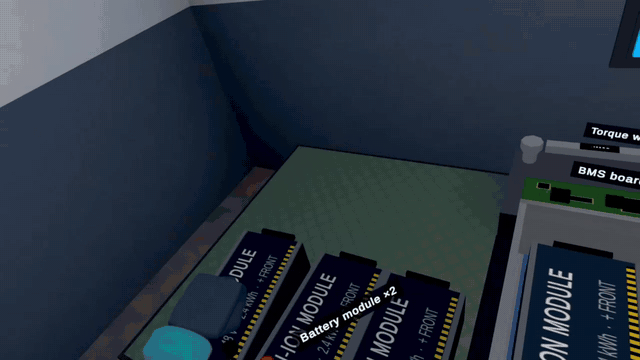
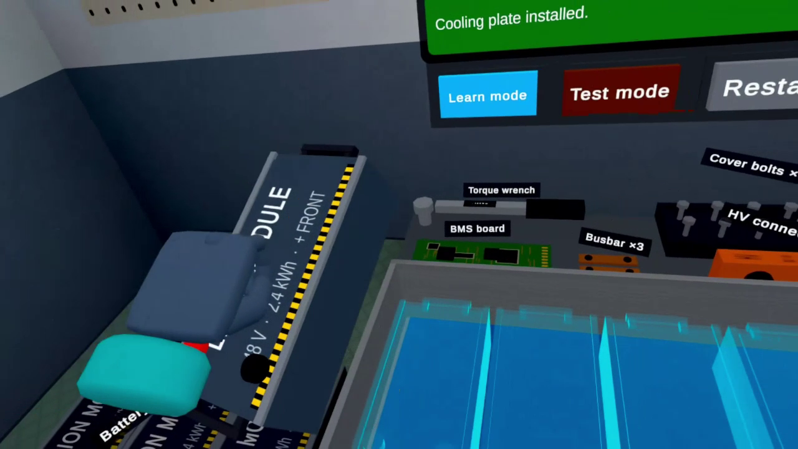
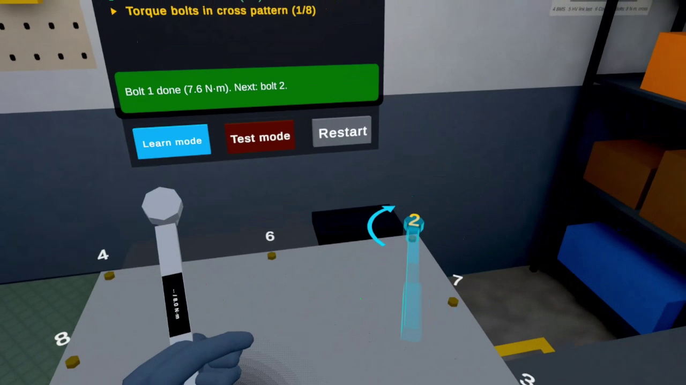
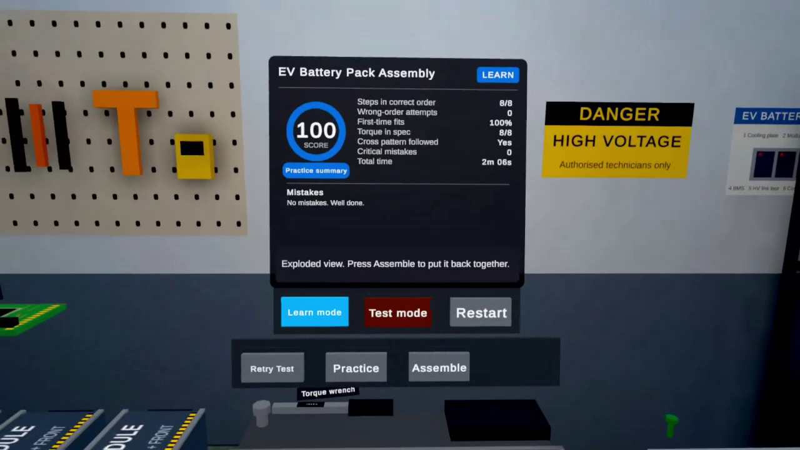
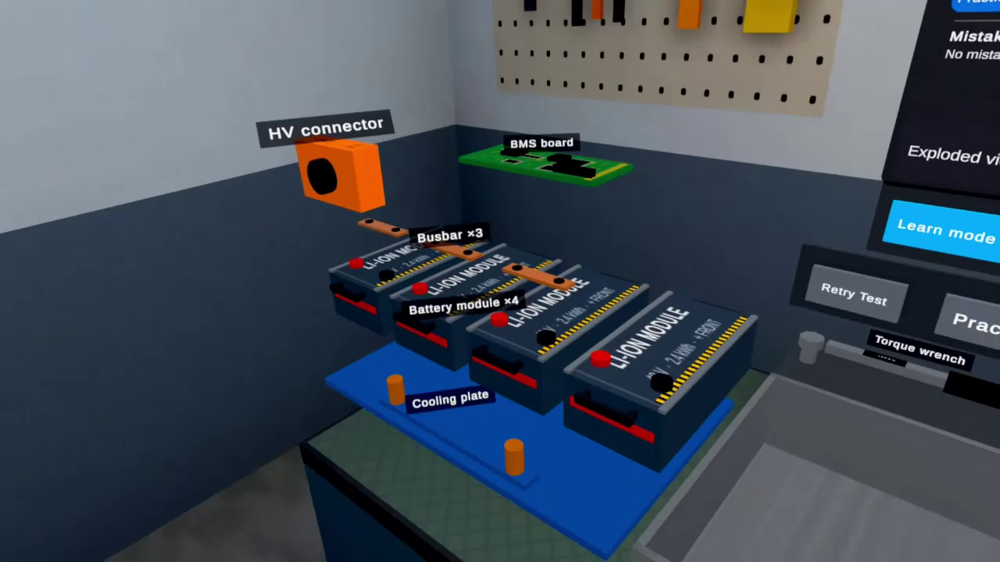
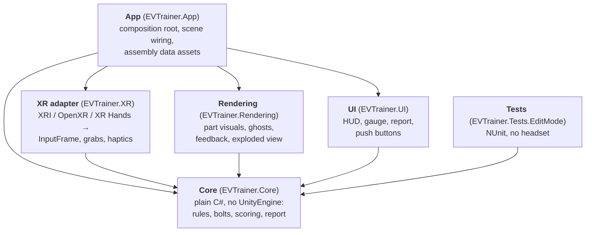

# EV Service Trainer

**EV Battery Pack Assembly training (VR, Meta Quest)**

EV Service Trainer is a virtual-reality assembly trainer for Meta Quest. The trainee builds an electric-vehicle
battery pack by hand: fitting the cooling plate, four battery modules, busbars, the BMS board and the HV connector in
the correct order and orientation, lifting the heavy pack cover with both hands, then hand-starting and torquing eight
cover bolts in a cross pattern to specification. Every action is validated against the procedure. Learn mode guides
with ghost targets and explanations; Test mode stays silent, logs every mistake and ends with a scored PASS / FAIL
report that is also saved as JSON.

[](https://youtu.be/n1DO1EG7Qcg)

[▶ Watch the demo (1:45)](https://youtu.be/n1DO1EG7Qcg)



| | |
|---|---|
|  |  |
|  |  |
|  |  |

---

## Features

- **Learn and Test modes.** Learn shows ghost outlines of each target pose, hints, pattern numbers and blocks wrong
  actions with an explanation. Test shows no guidance, allows mistakes and records them for scoring.
- **Step validation and wrong-order rules.** A prerequisite graph per part: a battery module offered before the
  cooling plate, or the HV connector before the BMS board, is rejected with the reason.
- **Snap assist with ghosts.** Released within the position and angle tolerance, a part settles into its exact
  pose with sound and haptics; outside it, the part stays loose. Battery modules are checked for orientation
  (+ terminal to the front); a busbar fits only once both modules it joins are in.
- **Two-hand cover lift.** The pack cover is too heavy for one hand: it lifts only when gripped with both.
- **Bolt hand-start with cross-thread check.** Bolts drop into their holes and are turned in by wrist rotation;
  starting a bolt tilted beyond the limit cross-threads it.
- **Torque wrench.** A ratchet wrench measured by swing angle around the bolt axis (backward swings ignored), with a
  live gauge, torque ring, click at 8 ± 0.4 N·m, cross-pattern sequence validation and over-torque detection.
- **Scoring and report.** Penalties per mistake type, critical mistakes (over-torque, a cross-threaded bolt left in),
  time adjustment, PASS / FAIL in Test (practice summary in Learn). The report panel shows steps in order, wrong-order
  attempts, first-time fits, torque in spec, pattern followed and total time; each run is exported as JSON.
- **Exploded view and disassembly review.** After completion the pack explodes into labelled layers, or replays its
  disassembly in reverse order.
- **Controllers and hand tracking.** Both drive the same interactions. Self-made glove hands follow tracked hand
  joints, or are posed by controller grip and trigger.
- **Poke UI.** Physical push buttons on a world-space console (mode select, restart, review), pressed with a
  fingertip or the controller glove's index finger.

## Tech stack

| | |
|---|---|
| Engine | Unity 6000.3.5f2, Universal Render Pipeline (URP 17.3) |
| XR | OpenXR 1.19.0 (Meta Quest feature group), XR Interaction Toolkit 3.3.1, XR Hands 1.7.2 |
| Input | Input System 1.17.0 |
| Target | Meta Quest 2 / 3 / 3S, Android, IL2CPP, ARM64 |
| Tests | Unity Test Framework (NUnit), Edit Mode |

No vendor SDKs: the project uses OpenXR and the Unity XR packages only.

## Architecture

All training logic lives in a plain C# **Core** assembly with no engine references (`noEngineReferences: true`,
maths via `System.Numerics`). Thin layers around it adapt the XR SDKs, draw the scene and show the UI; one App
layer wires everything together.



Why this shape:

- **Testable.** Every rule (prerequisites, snap tolerances, bolt states, torque, pattern, scoring) runs in Edit Mode
  tests in milliseconds, without a headset or Play Mode.
- **SDK-swappable.** XR types never leave the XR adapter. Controllers and tracked hands both become one plain
  `InputFrame`, so Core and UI never know which input is active, and a different XR SDK would replace only the
  adapter.
- **Data-driven.** Assemblies are defined as data (parts, slots, prerequisites, bolt patterns, torque specs), so new
  training procedures can be added without changing the Core logic.

More detail: [docs/ARCHITECTURE.md](docs/ARCHITECTURE.md).

## Testing

**280 NUnit Edit Mode tests** cover the Core logic:

- assembly rules: prerequisites, wrong order, part types and slots, orientation and symmetry, snap tolerances and
  snap assist;
- bolts: drop-in, hand-start, cross-threading, tightening and ratchet, torque spec and over-torque, cross-pattern
  validation, tool handling;
- scoring and output: mistake log, score calculator, report builder, report formatting and file pruning;
- interaction maths: hand gestures and smoothing, controller glove pose and poke point, push-button logic and
  hysteresis, axis angles, label layout, exploded-view timing, haptic profiles, synthesised sounds.

Run them in the Editor: **Window → General → Test Runner → EditMode → Run All**.

## Performance

- **Frame rate:** a steady 72 FPS through a full run on Meta Quest (non-development build, verified with the OVR Metrics Tool).
- **Scene budget (Editor measurement):** about 60 batches, 26 SetPass calls and 7k triangles per view during a run,
  from the Unity Editor frame stats.
- **Lighting:** fully baked lightmaps and a reflection probe; no real-time lights or shadows (held parts get a
  cheap blob shadow).
- **Rendering:** 4× MSAA, HDR off, simple opaque materials sharing one texture atlas; the ghosts are the only
  transparent objects.
- **Zero per-frame GC** during the run: text, labels and the report panel are prepared at scene start, and the
  per-frame paths (gauge, rings, labels, haptics) allocate nothing.

## Getting started

### Requirements

- Unity **6000.3.5f2** with the **Android Build Support** module (OpenJDK, Android SDK & NDK).
- A Meta Quest 2, 3 or 3S in [developer mode](https://developers.meta.com/horizon/documentation/native/android/mobile-device-setup/),
  and a USB cable.
- [adb](https://developer.android.com/tools/adb) (Android platform tools) on your PATH.

### Build from source

1. Clone the repository:
   ```bash
   git clone https://github.com/BRIJESH151089/EVServiceTrainer.git
   ```
2. Open the folder in Unity Hub with Unity 6000.3.5f2. Packages resolve from `Packages/manifest.json`.
3. Switch the platform to **Android** (File → Build Profiles) if it is not active.
4. Optional, for testing in the Editor without a headset: import the **XR Interaction Simulator** sample from
   XR Interaction Toolkit in the Package Manager. It is spawned automatically in Play Mode when no headset is
   active.
5. Build from the **EV Trainer → Release** menu:
   - **Build Quest Release APK**: the shipping build (debug panel and logs compiled out).
   - **Build Quest Development APK (profiling)**: profiler connection and script debugging.

   The APK is written to `Builds/EVServiceTrainer-1.0.0.apk`.

### Install on the Quest

```bash
adb install -r Builds/EVServiceTrainer-1.0.0.apk
```

On the headset, open **Library → Unknown Sources → EV Service Trainer**.

### Training reports

Every completed run is saved as JSON on the headset (the newest 20 are kept):

```
/sdcard/Android/data/com.brijeshyadav.evservicetrainer/files/reports/report_yyyyMMdd_HHmmss.json
```

Copy them to your computer:

```bash
adb pull /sdcard/Android/data/com.brijeshyadav.evservicetrainer/files/reports ./reports
```

## Development process

This project was developed with AI assistance: Claude Code (Anthropic) was used as a pair programmer for writing
code, tests and documentation. The architecture, design decisions, review of every change and all on-device testing
on the Quest were done by me.

## Disclaimer

EV Service Trainer is a demonstration and training prototype. It is **not certified safety training** and does not
qualify anyone to work on high-voltage systems. The procedure, values and parts are simplified for demonstration.
This project is not affiliated with, endorsed by or connected to any vehicle manufacturer.

## Credits

All 3D models, materials, textures and sounds are self-made, apart from the font and package resources listed in
[ASSETS_CREDITS.md](ASSETS_CREDITS.md).

## License

The source code is released under the [MIT License](LICENSE) © 2026 Brijesh Kumar Yadav. Third-party resources keep
their own licences (see [ASSETS_CREDITS.md](ASSETS_CREDITS.md)).
