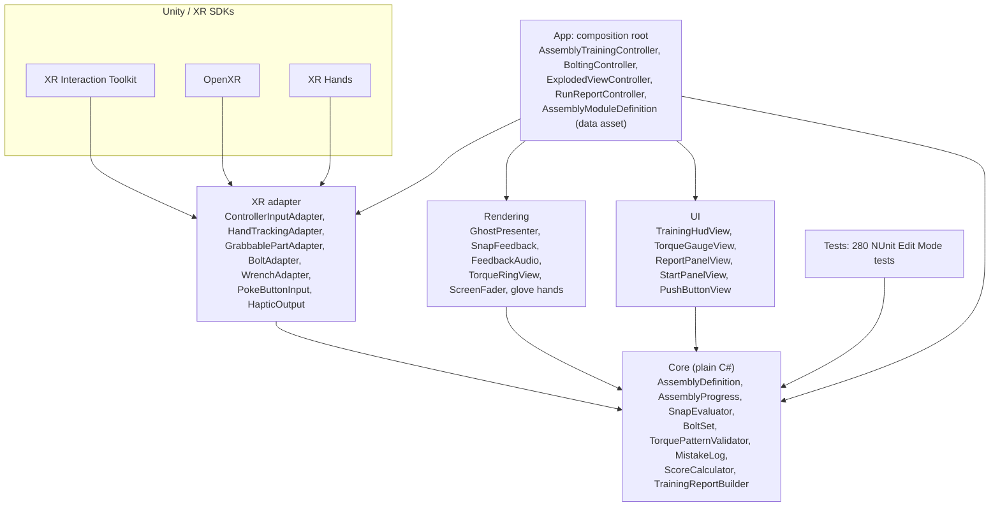
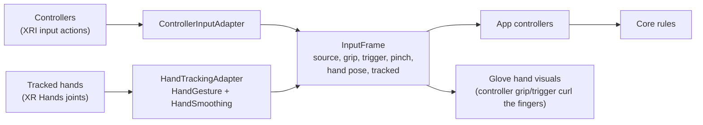
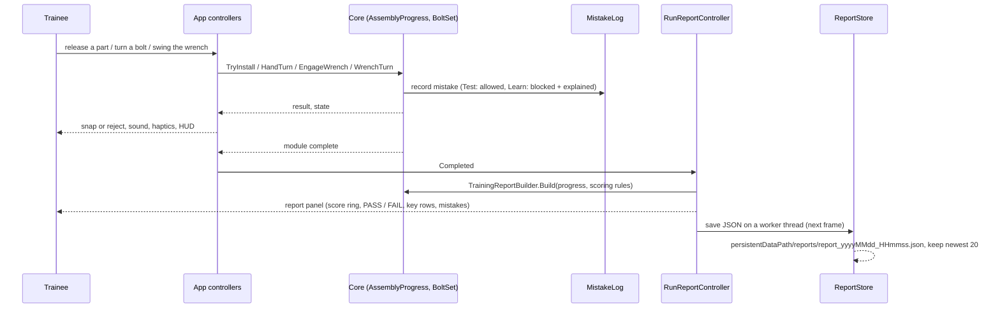

# Architecture

EV Service Trainer is split into six assemblies under `Assets/EVTrainer/`. The rule that shapes everything else:
**all training logic is plain C# in Core, with no reference to UnityEngine or any XR SDK.** The other layers measure,
draw and wire; they never decide.

| Assembly | Contains | References |
|---|---|---|
| `EVTrainer.Core` | Rules, state machines, maths (`System.Numerics`), scoring, report model. `noEngineReferences: true`. | nothing |
| `EVTrainer.XR` | Thin adapters over XRI, OpenXR and XR Hands. Converts SDK types to Core data. | Core, XRI, OpenXR, XR Hands |
| `EVTrainer.Rendering` | Part visuals, ghost shader, snap and reject effects, audio, torque ring, fades, glove hands. | Core |
| `EVTrainer.UI` | World-space HUD, step list, gauge, report panel, push buttons, labels. | Core |
| `EVTrainer.App` | Composition root, scene wiring, data assets converted into Core definitions, report files. | all of the above |
| `EVTrainer.Tests.EditMode` | NUnit tests for Core. | Core |

## Core domain

### Assembly and parts

- **`AssemblyDefinition`**: id, title, part slots, steps and bolt sets of one training procedure.
- **`PartSpec`**: one slot. Part type id (identical parts such as the four battery modules share a type), target
  pose (`PartPose`: position + rotation), position and angle tolerance, `RequiresTwoHands`, `PreInstalled`,
  prerequisites (slot ids that must be installed first) and optional symmetry (for example a busbar that fits
  either way round).
- **`SnapEvaluator`**: distance and angle between a pose and a target, symmetry-aware.
- **`SnapAssist`**: a per-mode capture zone (Learn is more forgiving than Test). A part released inside it is pulled
  into its exact pose.
- **`AssemblyProgress`**: run-time state. `TryInstall(typeId, pose, time, itemId)` picks the best free slot of
  that type and returns an `InstallResult`: `Installed`, `OutOfTolerance`, `WrongOrientation`, `WrongOrder`
  (with the missing prerequisites as the reason) or `AlreadyInstalled`. In Learn a wrong action is blocked and
  explained; in Test it is allowed but recorded in the `MistakeLog`.

### Bolts and torque

- **`BoltSpec`**: hole pose, thread turns to seat, torque spec ± tolerance, stiffness, maximum start tilt and
  hand-turn gearing.
- **`BoltTightening`**: one bolt's state machine:
  `Loose → Started → Seated → Torqued | OverTorqued | CrossThreaded`. Hand turns advance the thread; starting
  beyond the tilt limit cross-threads the bolt. After seating, wrench rotation raises torque through the stiffness.
- **`RatchetSwing`** and **`WrenchSpec`**: the torque wrench. The adapter measures the hand's angle around the bolt
  axis (atan2 on the plane perpendicular to the axis). Core turns that into drive degrees, ignores backward swings
  (the ratchet) and decides when the socket attaches to or comes off a head.
- **`TorquePatternValidator`**: the expected cross-pattern order. Each torqued bolt is `Ok`, `WrongSequence` or
  `Skipped`.
- **`BoltSet`**: the eight cover bolts together. Rules such as "hand-start all before torquing any", pattern checks
  per mode (blocked in Learn, logged in Test) and over-torque.

### Mistakes, score and report

- **`MistakeLog`**: every mistake with kind (`WrongOrder`, `WrongOrientation`, `NotSeated`, `CrossThread`,
  `TorqueBeforeAllSeated`, `WrongSequence`, `OverTorque`), item, step, time and reason.
- **`ScoreCalculator`** with **`ScoringRules`**: starts at 100, subtracts a penalty per mistake kind, adds or removes
  up to ±5 points against a target time, and clamps to 0–100. Any critical mistake (over-torque, or a cross-threaded
  bolt left in) fails the run regardless of score. The pass mark is 80. Learn runs are scored as practice, with no
  time effect and no pass or fail.
- **`TrainingReportBuilder`**: builds a serialisable `TrainingReport` (summary, steps with times and attempts,
  mistakes, final torque of every bolt). **`ReportFormat`** produces the panel texts; **`ReportFiles`** names files
  and decides which old reports to prune.

Supporting Core types cover interaction maths that would otherwise hide in MonoBehaviours: `HandGesture` and
`HandSmoothing` (pinch and grip from joints), `GloveMount`, `GloveHandLayout` and `ControllerPokePoint` (glove
hand poses on controllers), `PushButtonLogic` and `ButtonHysteresis`, `LabelLayout`, `ExplodedView` timing,
`HapticProfiles` and `SoundSynth` (procedural audio).

## The data-driven assembly asset

The procedure is a ScriptableObject, **`AssemblyModuleDefinition`** (`App/Content/BatteryPack.asset`). It holds:

- **parts**: id, type id, display and group names, Learn instruction and hint, target position and rotation relative
  to the fixture, tolerances, symmetry, two-hand flag, pre-installed flag, prerequisites, exploded-view offset;
- **bolt sets**: holes, pattern order, thread turns, torque spec and tolerance, stiffness, cross-thread tilt limit,
  capture zones per mode, wrench attach and detach geometry, tool return time;
- **snap assist** capture zones per mode, exploded-view timing;
- **scoring**: penalty per mistake kind, critical kinds, pass score, target time, time-adjustment rate and cap.

At scene start `AssemblyModuleDefinition.ToCore(fixtureTransform)` converts it to a plain `AssemblyDefinition`
(Unity vectors become `System.Numerics`, local poses become world poses), and `ToScoringRules()` gives the Core
scoring rules. Core never sees the asset. Assemblies are defined as data (parts, slots, prerequisites, bolt
patterns, torque specs), so new training procedures can be added without changing the Core logic.

## Adapter boundaries

The XR layer only measures and actuates. It never applies a rule.

| Adapter | Reads from the SDK | Gives to the App / Core |
|---|---|---|
| `ControllerInputAdapter` | XRI interactor select / activate input, controller pose | `InputFrame` (source = Controller), `IsHolding`, haptic pulses |
| `HandTrackingAdapter` | XR Hands subsystem joints | `InputFrame` (source = Hand), debounced grab acting as the XRI select input |
| `GrabbablePartAdapter` | XRGrabInteractable grab and release | `PartRelease` (type id, item id, pose as `PartPose`, source, hand); snap, lock and two-hand rules applied by the App |
| `BoltAdapter`, `WrenchAdapter` | Grab state, hand and socket positions | Poses and positions; the App feeds measured angles to `BoltSet` and `RatchetSwing` and poses the parts from the result |
| `PokeButtonInput` | Poke points of fingertips and glove index fingers | Press depth for `PushButtonLogic` |
| `HapticOutput` | n/a | Sends Core `HapticPulse` values to the holding controller |

`NumericsConversion` is the single place where `UnityEngine.Vector3/Quaternion` and `System.Numerics` meet.

## Input pipeline

`InputFrame` is a plain struct: `Source` (Controller or Hand), `Grip`, `Trigger` and `Pinch` (0..1), `HandPose` and
`IsTracked`. Controllers and hands both produce it, so Core and UI never know which source is active. Hand tracking
turns joint distances into pinch and grip (`HandGesture`), smooths them (`HandSmoothing`) and debounces the grab.
On controllers, the same glove hands are mounted on the grip pose (`GloveMount`) and curled by grip and trigger.

## Scoring and report flow

The start panel of the next session reads the newest file and shows the last result. Retry Test and Practice reload
the scene straight into the chosen mode.

## Performance choices

- Baked lighting only, no real-time lights or shadows. Held parts get a blob shadow.
- One texture atlas and a few opaque materials; static batching for the workshop. The ghosts are the only
  transparent surfaces.
- Text, labels and the report panel are laid out at scene start, behind the fade-in. Per-frame code paths (gauge,
  rings, labels, haptics, input) allocate nothing.
- Release builds compile out the debug panel, joint spheres and info logs (`DEVELOPMENT_BUILD || UNITY_EDITOR`).
